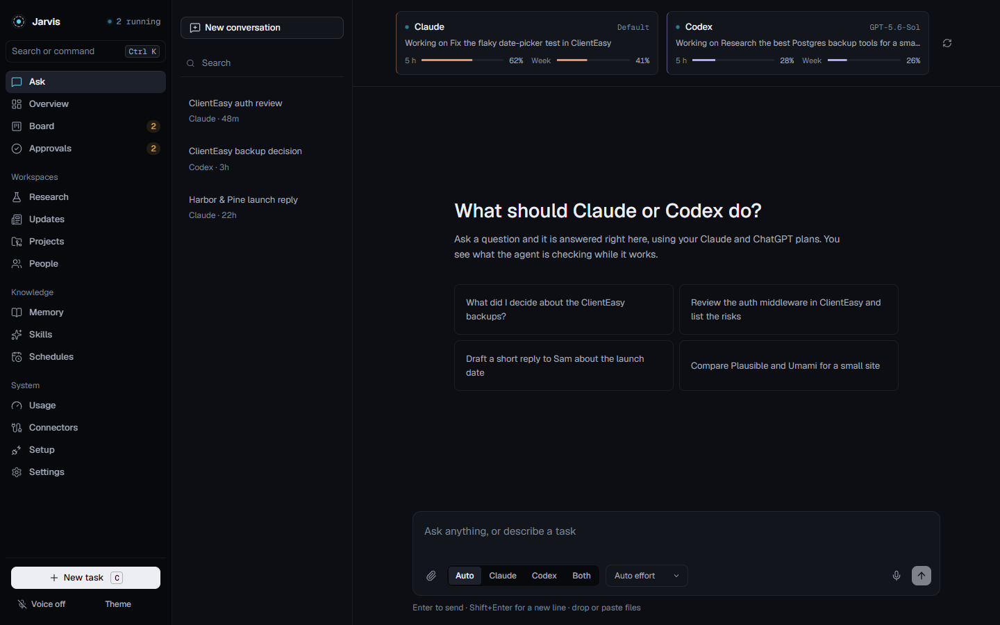

# Jarvis

A local command centre for work carried out by Claude Code and Codex. Capture a task, route it to an agent, follow its progress, and keep results connected to projects and a Markdown memory vault.

Jarvis combines a task board, streamed conversations, approval workflows, schedules, and optional Telegram access in a single-user application. It uses the official agent SDKs rather than implementing its own coding harness.

**Status:** active personal project. Start with the mock demo and a sample vault before connecting your own files or agent accounts. No project license has been selected yet.



## Try the demo

You need Node.js 24+ and Git. No agent login or model API key is required for the mock demo.

```sh
git clone https://github.com/mukheshvadlamudi/jarvis.git
cd jarvis
npm install
npm run demo
```

The launcher builds the web interface, creates local configuration on first run, and starts Jarvis at [http://127.0.0.1:4317](http://127.0.0.1:4317). Demo mode uses scripted agent runs and a working copy of the sample vault.

The launcher also supports `npm run app`, or the platform scripts `start-jarvis.cmd`, `start-jarvis.command`, and `start-jarvis.sh`. See the [installation guide](docs/INSTALL.md) for desktop packaging and setup details.

## Connect real agents

Real runs require accounts that can authenticate with the bundled Claude Code and Codex tools. Availability and usage limits depend on your accounts. Jarvis is configured to use CLI logins and strips model API-key variables from spawned agent environments.

```sh
npm run login:claude
npm run login:codex
npm run app
```

If you first ran the demo, change `JARVIS_RUNNER=mock` to `JARVIS_RUNNER=real` in `.env` before launching the real app. The demo flag overrides this setting only for that demo launch.

Use Setup to select your vault and project folders. Begin with a disposable project to understand the agent permissions, worktrees, and approval behavior before assigning work on important files.

## What you can do

| Workspace | Purpose |
| --- | --- |
| Ask | Streamed conversations, attachments, agent selection, second opinions, and handoffs |
| Board and run view | Queue tasks, inspect tool activity and changes, follow up, or cancel |
| Approvals | Review actions that the application routes through its approval policy |
| Projects | Register local repositories and inspect task worktrees and changes |
| Memory and skills | Search a Markdown vault, review proposed edits, and sync selected skills |
| Schedules and updates | Run routines and collect RSS, release, and page-change updates |
| Usage | Inspect available usage readings and run token totals |
| People | Track follow-ups from vault notes |
| Voice | Optional local speech components and hands-free interaction |
| Telegram | Optional task capture and approval notifications |

## Architecture

```text
React web UI / Electron shell / Telegram
                    ↓
          Hono API + task scheduler
                    ↓
        routing / approvals / memory
              ↙                ↘
     Claude Agent SDK       Codex SDK
              ↘                ↙
        local projects + Markdown vault
                    ↓
         SQLite + streamed run events
```

| Path | Purpose |
| --- | --- |
| `server/src/` | API, persistence, routing, runners, memory, and scheduling |
| `web/src/` | React interface built with Vite |
| `desktop/` | Electron desktop shell |
| `fixtures/vault/` | Sample memory used for demos and tests |
| `scripts/` | Launchers, login helpers, and packaging |
| `docs/` | Installation, design, decisions, and screenshots |

## Configuration

The launcher creates `.env` from [.env.example](.env.example) if needed. For manual development, copy that file yourself. Keep credentials and real vault content out of Git.

| Variable | Purpose |
| --- | --- |
| `JARVIS_RUNNER` | `mock` for scripted runs; `real` for authenticated agents |
| `JARVIS_VAULT` | Markdown vault directory; start with the fixture path |
| `JARVIS_BIND` / `JARVIS_PORT` | Server address; defaults to loopback on port 4317 |
| `JARVIS_ACCESS_TOKEN` | Required when configuring non-loopback access |
| `TELEGRAM_BOT_TOKEN` / `TELEGRAM_ALLOWED_CHAT_ID` | Optional Telegram integration |
| `JARVIS_PUBLIC_URL` | Base URL included in Telegram links |
| `JARVIS_FEEDS_FETCH` | Set to `1` to enable feed fetching in mock mode |

Runtime configuration, SQLite data, and run artifacts live under the ignored `data/` directory. Some tasks also write to configured project worktrees or the selected vault. Back up important data before using real agents.

## Development

```sh
npm run dev
```

Development runs the API on port 4317 and the web UI at [http://127.0.0.1:5173](http://127.0.0.1:5173). Set `JARVIS_RUNNER=mock` in `.env` to develop without real agent calls.

```sh
npm test
npm run typecheck
npm run build
```

The automated server tests configure the mock runner. Real-account smoke commands (`npm run smoke:claude` and `npm run smoke:codex`) are separate, make actual agent calls, and should only be run deliberately by an authenticated owner.

For UI changes, follow [docs/DESIGN.md](docs/DESIGN.md) and the repository instructions. The screenshot helper is `node web/scripts/screenshots.mjs` after building and with the required local app/browser setup available.

Desktop development uses `npm run desktop`. Installer commands are `npm run package:win`, `npm run package:mac`, and `npm run package:linux`; platform requirements are described in [docs/INSTALL.md](docs/INSTALL.md).

## Permissions and limitations

Jarvis is designed for one trusted local user. Keep the default loopback binding unless you have deliberately configured remote access and a token. It is not a hardened multi-user hosting service.

Approval handling depends on the selected runner. Claude uses a per-tool permission callback; the Codex integration relies on its configured execution permissions and the Jarvis approval-tool instructions. The approval UI should not be treated as a universal security boundary. Review the implementation before granting agents access to sensitive projects or connectors.

Usage readings depend on SDK and CLI behavior and may be unavailable or delayed. Agent integrations and optional voice components can need updates as their dependencies change. Real account access, desktop installers, and voice performance must be checked in the environment where you intend to use them.

## Troubleshooting

- **Node version error:** use Node.js 24 or newer; the server uses built-in SQLite and direct TypeScript execution.
- **Demo still active:** remove the demo flag and set `JARVIS_RUNNER=real` in `.env`.
- **Agent authentication fails:** run the corresponding `login:*` command and confirm account access in the official CLI.
- **Port in use:** close the other instance or set `JARVIS_PORT` to an available port.
- **Missing usage data:** confirm the CLI is producing supported session/usage information; do not infer remaining quota from absent data.

## Contributing

Read [AGENTS.md](AGENTS.md), [CLAUDE.md](CLAUDE.md), and [SPEC.md](SPEC.md) before changing the code. Open a focused pull request with reproduction steps or a clear explanation of the improvement. Run tests with the mock runner and run type checking before submission. UI changes also need the documented visual checks.

Use fixtures instead of real vaults, avoid account-dependent tests, and never include authentication stores, `.env`, runtime data, or private transcripts. Discuss major changes to the single-user architecture first.

## License

No license for the project code is included. An open-source license must be selected before a public open-source release. Vendored assets and skills retain their own notices and terms.
